<div class="titlepage"></div>

# System Architecture and Design {.unnumbered .title-heading}

*Architecture, data design and API reference (generated from the code)*

| | |
|---|---|
| **Project title** | IntelliMetrics AI: A Governed Semantic Layer with TARA, an AI Assistant for Trusted Business Metrics |
| **Document** | System Architecture and Design |
| **Team members** | Devi Priya, Priyanka, Akshay and Bhaskar |
| **Guide** | Dr. Asesh Kumar Tripathy |
| **Institution** | KL University |
| **Academic year** | 2026-27 |
| **Date** | 24-Oct-2026 (IST) |
| **Status** | University project: academic capstone with synthetic demonstration data |

```{=openxml}
<w:p><w:r><w:br w:type="page"/></w:r></w:p>
```

```{=html}
<div style="page-break-after:always"></div>
```


## Table of contents {.unnumbered}

- [1 Overview](#sec-1)
- [2 High-level architecture](#sec-2)
- [3 Component diagram](#sec-3)
- [4 Deployment diagram](#sec-4)
- [5 Request flow: Ask TARA](#sec-5)
- [6 Dataset ingestion pipeline](#sec-6)
- [7 Formula compile pipeline](#sec-7)
  - [7.1 Grammar](#sec-7-1)
- [8 Conflict detection flow](#sec-8)
- [9 State machines](#sec-9)
- [10 Security architecture](#sec-10)
  - [10.1 Role-based access control](#sec-10-1)
  - [10.2 Workspace isolation](#sec-10-2)
  - [10.3 Other controls](#sec-10-3)
- [11 Indian calendar and planner](#sec-11)
- [12 Data design](#sec-12)
  - [12.1 Entity-relationship diagram](#sec-12-1)
  - [12.2 Data dictionary](#sec-12-2)
- [13 API reference summary](#sec-13)
- [14 Use cases by role](#sec-14)

```{=openxml}
<w:p><w:r><w:br w:type="page"/></w:r></w:p>
```

```{=html}
<div style="page-break-after:always"></div>
```


# 1 Overview {#sec-1}

IntelliMetrics AI is a three-layer web application with a separate background-job layer. This document describes the architecture with diagrams, the data design (ER diagram and data dictionary) and the API. The API reference, data dictionary, permission matrix and statistics in this document are **generated from the source code** by `docs/tools/gen_reference.py`; they are not hand-written, so they cannot drift from the implementation.

| Fact (generated) | Value |
|---|---|
| API endpoints | 96 |
| Routers | 16 |
| Database tables | 20 |
| Role capabilities | 19 |
| Back-end source | 46 Python files, 7,115 lines |
| Back-end tests | 7 files, 1,072 lines |
| Front-end source | 54 TypeScript files, 4,707 lines; 25 page components |
| End-to-end tests | 2 files, 292 lines |

# 2 High-level architecture {#sec-2}

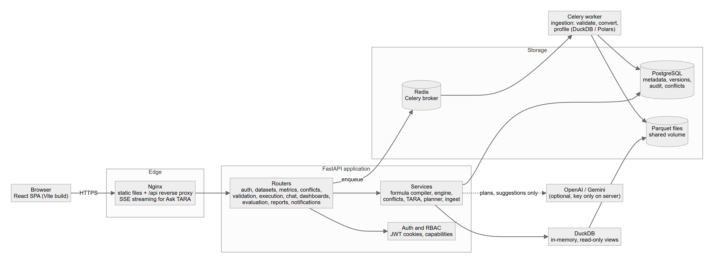{width=95%}


The browser talks only to Nginx (production) or the Vite dev proxy (development), so the SPA and API share one origin and the httpOnly cookies are first-party. FastAPI authenticates every request, authorises it by capability, filters every query by workspace, and delegates work to services. Long-running ingestion is placed on a Celery queue (Redis) and executed by a worker. Analytical queries are never sent to PostgreSQL: they run in DuckDB over Parquet files produced by ingestion.

# 3 Component diagram {#sec-3}

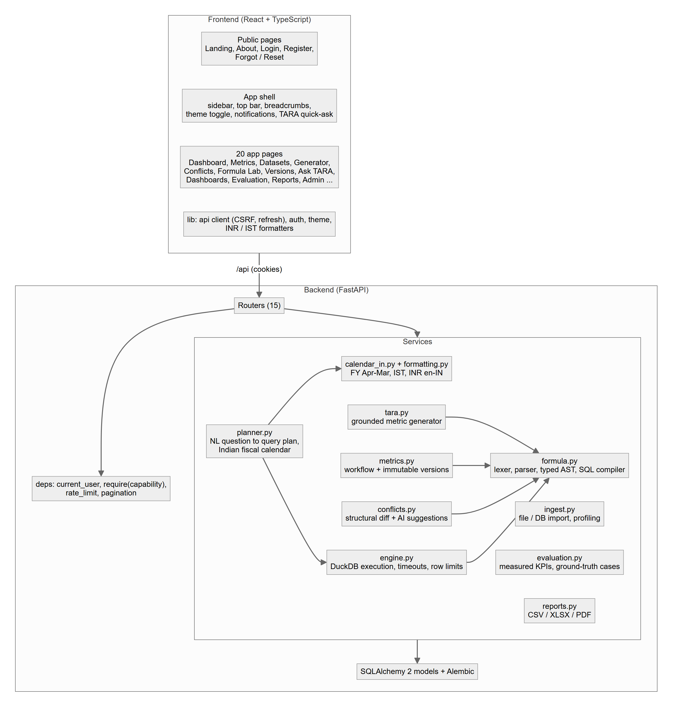{width=85%}


Responsibilities are layered so that safety-critical logic exists once: the **formula compiler** is used by the Formula Lab, metric validation, the TARA generator, the Ask TARA pipeline, dashboards and the evaluation module. The **planner** only produces a query plan; the **engine** executes it.

# 4 Deployment diagram {#sec-4}

{width=85%}


Persistent volumes: `pgdata` (PostgreSQL), `redisdata` (Redis append-only file) and `datasets` (raw uploads and Parquet), the last mounted in both the API and the worker so the worker's output is visible to the API. The backend container runs `alembic upgrade head` on every start and seeds the demonstration data when `AUTO_SEED=true` and the database is empty.

# 5 Request flow: Ask TARA {#sec-5}

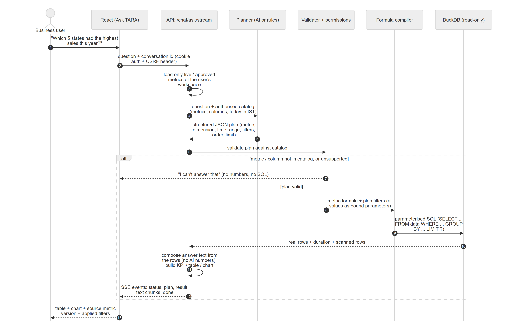{width=100%}


Key safety properties of this flow:

1. The planner receives only the **authorised catalog** (live or approved metrics of the user's own workspace on ready datasets) and today's date in IST.
2. Its output is a JSON *plan*, validated by Pydantic and then by `validate_plan`, which rejects unknown metrics or columns; a forged plan cannot reach the database.
3. The SQL is produced by the same compiler as in the Formula Lab; every value is a bound parameter.
4. The answer text is composed from the returned rows; the AI does not write the figures.

# 6 Dataset ingestion pipeline {#sec-6}

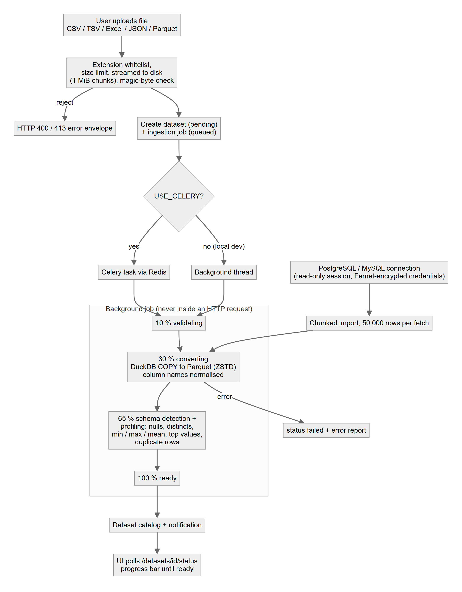{width=75%}


Uploads are streamed to disk in 1 MiB chunks with an extension whitelist, a size limit and a magic-byte check. The job converts to ZSTD-compressed Parquet with DuckDB `COPY` (CSV rejects are recorded in an error report), normalises column names to snake_case, detects the schema and the default date column, and profiles every column in a single scan (null counts, approximate distinct counts, min, max, mean, standard deviation, top values) plus a duplicate-row count. External PostgreSQL/MySQL tables are streamed in 50,000-row chunks through a read-only session into a PyArrow Parquet writer.

# 7 Formula compile pipeline {#sec-7}

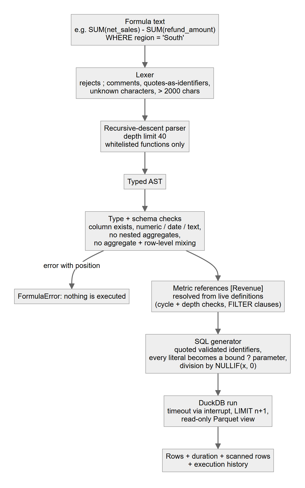{width=60%}


## 7.1 Grammar {#sec-7-1}

```
formula   := expr [ WHERE bool ]
expr      := term (('+' | '-') term)*
term      := unary (('*' | '/' | '%') unary)*
unary     := '-' unary | primary
primary   := NUMBER | STRING | DATE STRING | TRUE | FALSE | NULL
           | '(' expr ')' | call | IDENT | '[' Metric Name ']'
call      := NAME '(' [ '*' | arg (',' arg)* ] ')'     -- whitelisted NAME only
bool      := and (OR and)* ;  and := not (AND not)* ;  not := [NOT] cmp
cmp       := expr (('='|'!='|'<>'|'<'|'<='|'>'|'>=') expr
                  | [NOT] IN '(' expr (',' expr)* ')' | [NOT] BETWEEN expr AND expr
                  | [NOT] LIKE STRING | IS [NOT] NULL) | '(' bool ')'
aggregates: SUM AVG MIN MAX COUNT COUNT_DISTINCT MEDIAN STDDEV SUMIF COUNTIF AVGIF
scalars:    ABS ROUND COALESCE IF NULLIF UPPER LOWER YEAR MONTH LENGTH
```

Limits: 2,000 characters, nesting depth 40, 200 items per `IN` list, 10,000 returned rows, 20-second timeout (all configurable). Semantic rules: columns must exist (a close-match suggestion is offered), `SUM/AVG/MEDIAN/STDDEV` require numeric input, text and date comparisons are type-checked, ISO date strings are coerced to dates, aggregates cannot be nested or mixed with row-level columns, a top-level formula must be a numeric aggregate expression, metric references must be live and defined on the same dataset.

# 8 Conflict detection flow {#sec-8}

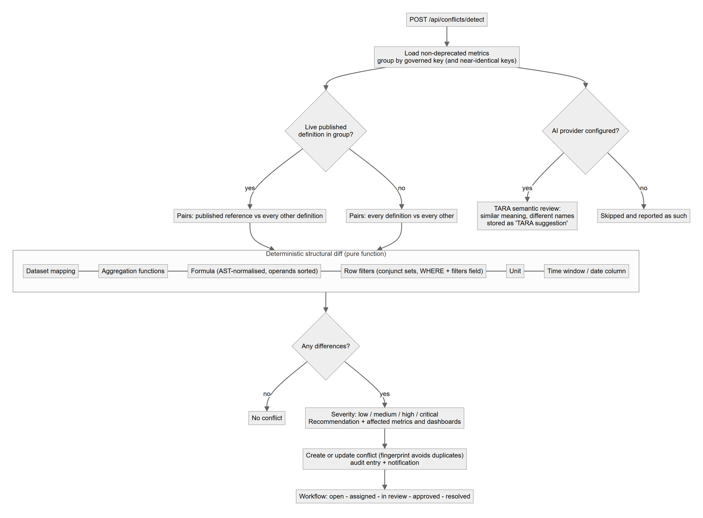{width=80%}


Severity rules: the maximum severity of the differences, raised to *critical* when the reference is live and the variant is already in review/approved/published with a formula, aggregation or dataset difference, or when three or more difference types are present together with a high one.

# 9 State machines {#sec-9}

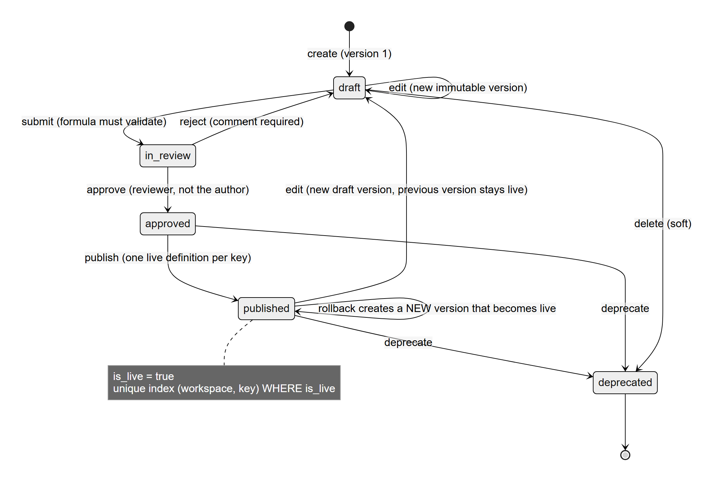{width=75%}


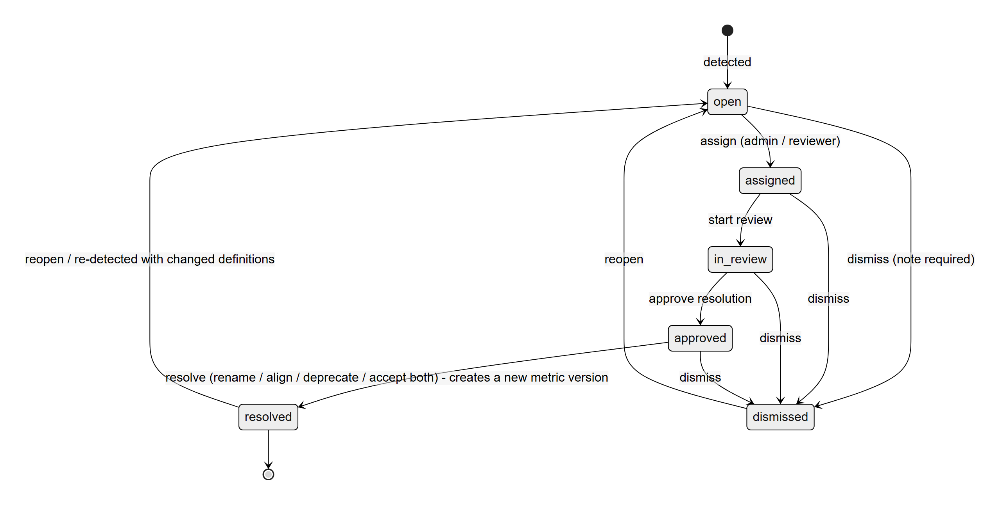{width=75%}


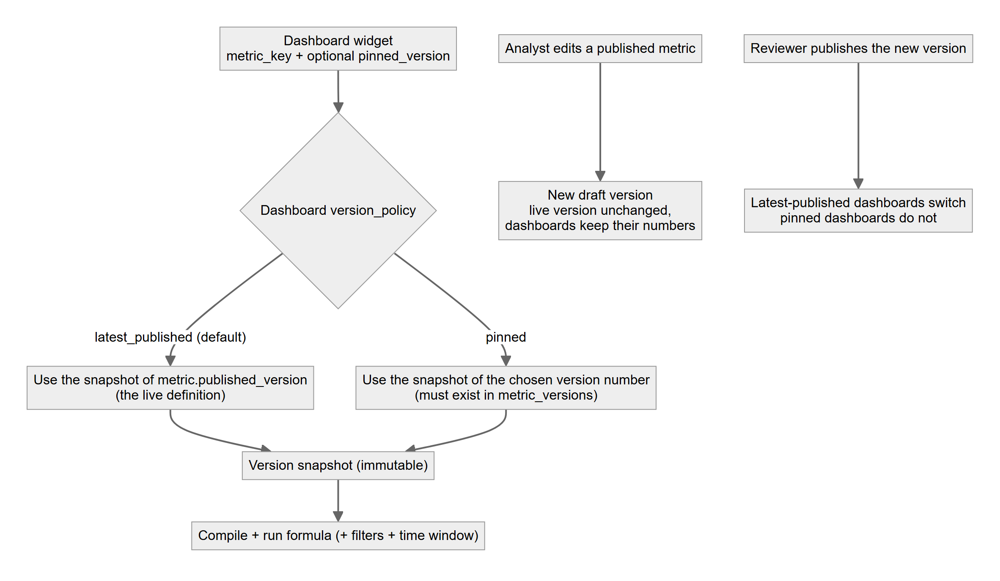{width=70%}


# 10 Security architecture {#sec-10}

## 10.1 Role-based access control {#sec-10-1}

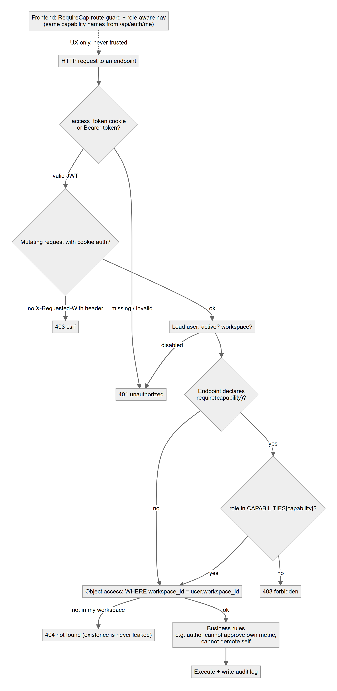{width=60%}


| Capability | Admin | Data Analyst | Business User | Reviewer |
|---|:-:|:-:|:-:|:-:|
| View metrics catalog, datasets, dashboards (`catalog.view`) | Yes | Yes | Yes | Yes |
| Upload datasets / manage connections (`dataset.write`) | Yes | Yes | - | - |
| Delete datasets and connections (`dataset.delete`) | Yes | - | - | - |
| Create and edit metrics (`metric.write`) | Yes | Yes | - | - |
| Approve / reject / publish / deprecate metrics (`metric.review`) | Yes | - | - | Yes |
| Roll back a metric (creates a new version) (`metric.rollback`) | Yes | - | - | Yes |
| Use TARA metric generator (`ai.generate`) | Yes | Yes | - | - |
| Ask TARA (natural-language BI) (`chat.ask`) | Yes | Yes | Yes | Yes |
| View conflicts (`conflict.view`) | Yes | Yes | Yes | Yes |
| Run conflict detection (`conflict.detect`) | Yes | Yes | - | Yes |
| Assign / review / resolve conflicts (`conflict.manage`) | Yes | - | - | Yes |
| Formula Lab: validate and execute (`formula.run`) | Yes | Yes | - | Yes |
| Create / edit dashboards (`dashboard.write`) | Yes | Yes | Yes | - |
| View performance evaluation (`evaluation.view`) | Yes | Yes | - | Yes |
| Run performance evaluation (`evaluation.run`) | Yes | Yes | - | - |
| Export reports (`report.export`) | Yes | Yes | Yes | Yes |
| Manage users and roles (`user.manage`) | Yes | - | - | - |
| Manage workspace and settings (`workspace.manage`) | Yes | - | - | - |
| View audit log (`audit.view`) | Yes | - | - | - |


Additional rules enforced in code: an author cannot approve their own metric (except an Admin); rejection requires a comment; users cannot demote or deactivate themselves; demo-account passwords cannot be changed; every sensitive action is audit-logged with user, entity, details, IP and request id.

## 10.2 Workspace isolation {#sec-10-2}

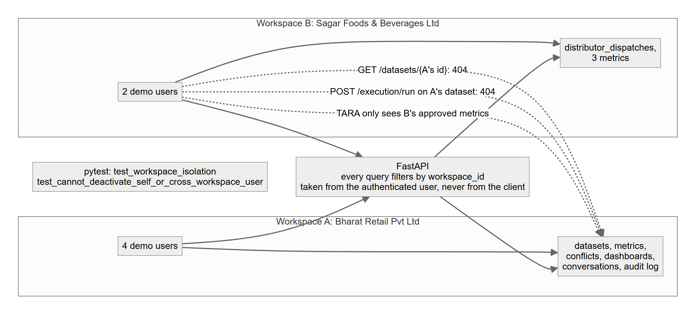{width=85%}


## 10.3 Other controls {#sec-10-3}

| Control | Implementation |
|---|---|
| Password storage | Argon2id hashes (argon2-cffi) |
| Sessions | JWT access token (15 min) and rotating refresh token (7 days, stored hashed) in httpOnly, SameSite cookies; `Secure` when `COOKIE_SECURE=true` |
| CSRF | State-changing cookie-authenticated requests must carry `X-Requested-With: IntelliMetrics` |
| Rate limiting | Sliding window per IP on authentication routes (per process) |
| Secrets | Environment variables only; connection passwords encrypted with Fernet; AI keys never reach the browser |
| Input validation | Pydantic v2 on every request; consistent error envelope with request id |
| SQL safety | No raw SQL accepted; restricted grammar; parameters; read-only DuckDB views; timeouts and row limits |
| Upload safety | Extension whitelist, size limit, magic-byte sniffing, binary rejection, stored outside the web root |
| Immutability | ORM guard plus database trigger on `metric_versions` |

# 11 Indian calendar and planner {#sec-11}

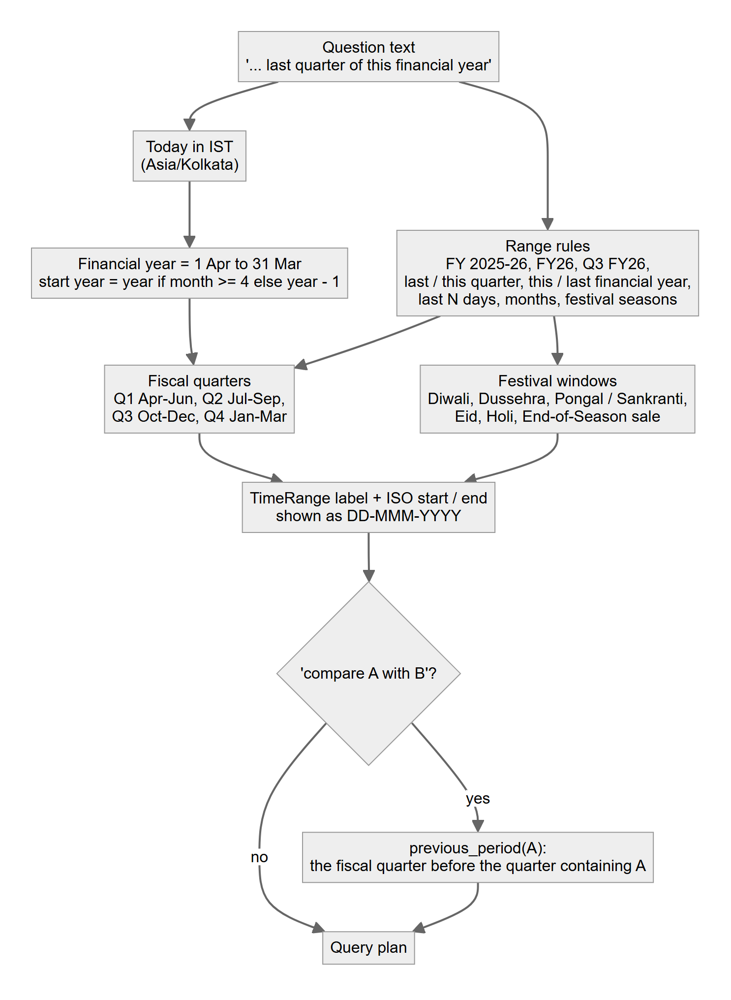{width=60%}


# 12 Data design {#sec-12}

## 12.1 Entity-relationship diagram {#sec-12-1}

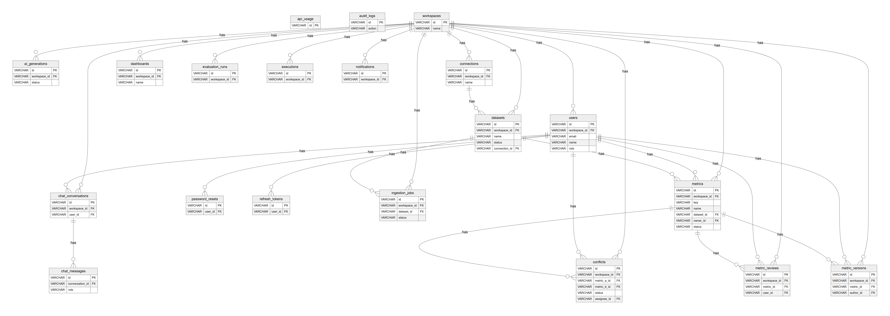{width=100%}


The diagram is wide; for a legible full-size version open `docs/diagrams/er.svg` (zoomable vector) or `docs/diagrams/er.png`. Notes: every business table references `workspaces` (tenant boundary). `metrics` holds the working copy; `metric_versions` holds immutable snapshots; `metric_reviews` is the append-only approval log; `conflicts` references the reference metric and the variant; `dashboards.widgets` is a JSON layout whose entries reference metric keys and optional pinned version numbers; `ingestion_jobs` and `executions` are the telemetry that the evaluation module analyses.

## 12.2 Data dictionary {#sec-12-2}


**`api_usage`**: AI provider call log used for usage statistics.

| Column | Type | Null | Key / constraint |
|---|---|:-:|---|
| `id` | VARCHAR | no | PK |
| `workspace_id` | VARCHAR | no | indexed |
| `provider` | VARCHAR | no |  |
| `kind` | VARCHAR | no |  |
| `tokens_est` | INTEGER | no |  |
| `latency_ms` | FLOAT | no |  |
| `ok` | BOOLEAN | no |  |
| `created_at` | DATETIME | no |  |

**`audit_logs`**: Audit trail of every sensitive action with user, entity, details, IP and request id.

| Column | Type | Null | Key / constraint |
|---|---|:-:|---|
| `id` | VARCHAR | no | PK |
| `workspace_id` | VARCHAR | yes | indexed |
| `user_id` | VARCHAR | yes |  |
| `user_email` | VARCHAR | yes |  |
| `action` | VARCHAR | no | indexed |
| `entity_type` | VARCHAR | yes | indexed |
| `entity_id` | VARCHAR | yes | indexed |
| `details` | JSON | no |  |
| `ip` | VARCHAR | yes |  |
| `request_id` | VARCHAR | yes |  |
| `created_at` | DATETIME | no | indexed |

**`workspaces`**: Tenant boundary. Every other table carries a workspace_id; settings JSON holds AI provider, theme and retention.

| Column | Type | Null | Key / constraint |
|---|---|:-:|---|
| `id` | VARCHAR | no | PK |
| `name` | VARCHAR | no |  |
| `slug` | VARCHAR | no | unique |
| `is_demo` | BOOLEAN | no |  |
| `settings` | JSON | no |  |
| `created_at` | DATETIME | no |  |

**`ai_generations`**: TARA metric-generator suggestions with mode (ai/offline), validity, acceptance and latency.

| Column | Type | Null | Key / constraint |
|---|---|:-:|---|
| `id` | VARCHAR | no | PK |
| `workspace_id` | VARCHAR | no | FK -> workspaces.id, indexed |
| `user_id` | VARCHAR | yes |  |
| `prompt` | TEXT | no |  |
| `dataset_id` | VARCHAR | yes |  |
| `mode` | VARCHAR | no |  |
| `provider` | VARCHAR | yes |  |
| `latency_ms` | FLOAT | no |  |
| `output` | JSON | no |  |
| `valid` | BOOLEAN | no |  |
| `status` | VARCHAR | no |  |
| `metric_id` | VARCHAR | yes |  |
| `accepted` | BOOLEAN | no |  |
| `error` | TEXT | yes |  |
| `created_at` | DATETIME | no |  |

**`connections`**: External PostgreSQL/MySQL connections; the password is Fernet-encrypted at rest.

| Column | Type | Null | Key / constraint |
|---|---|:-:|---|
| `id` | VARCHAR | no | PK |
| `workspace_id` | VARCHAR | no | FK -> workspaces.id, indexed |
| `name` | VARCHAR | no |  |
| `kind` | VARCHAR | no |  |
| `host` | VARCHAR | no |  |
| `port` | INTEGER | no |  |
| `database` | VARCHAR | no |  |
| `username` | VARCHAR | no |  |
| `password_enc` | TEXT | no |  |
| `options` | JSON | no |  |
| `last_status` | VARCHAR | yes |  |
| `last_error` | TEXT | yes |  |
| `last_tested_at` | DATETIME | yes |  |
| `created_by` | VARCHAR | yes |  |
| `created_at` | DATETIME | no |  |

**`dashboards`**: Saved dashboards: widget layout JSON, filters and the version policy (latest_published or pinned).

| Column | Type | Null | Key / constraint |
|---|---|:-:|---|
| `id` | VARCHAR | no | PK |
| `workspace_id` | VARCHAR | no | FK -> workspaces.id, indexed |
| `name` | VARCHAR | no |  |
| `description` | TEXT | yes |  |
| `widgets` | JSON | no |  |
| `filters` | JSON | no |  |
| `version_policy` | VARCHAR | no |  |
| `template` | VARCHAR | yes |  |
| `created_by` | VARCHAR | yes |  |
| `created_at` | DATETIME | no |  |
| `updated_at` | DATETIME | no |  |

**`evaluation_runs`**: Stored results of each performance evaluation run.

| Column | Type | Null | Key / constraint |
|---|---|:-:|---|
| `id` | VARCHAR | no | PK |
| `workspace_id` | VARCHAR | no | FK -> workspaces.id, indexed |
| `user_id` | VARCHAR | yes |  |
| `results` | JSON | no |  |
| `duration_ms` | FLOAT | no |  |
| `created_at` | DATETIME | no |  |

**`executions`**: History of validations and executions (Formula Lab, Ask TARA, dashboards) with duration, scanned rows and error.

| Column | Type | Null | Key / constraint |
|---|---|:-:|---|
| `id` | VARCHAR | no | PK |
| `workspace_id` | VARCHAR | no | FK -> workspaces.id, indexed |
| `user_id` | VARCHAR | yes |  |
| `dataset_id` | VARCHAR | yes |  |
| `kind` | VARCHAR | no |  |
| `expression` | TEXT | yes |  |
| `ok` | BOOLEAN | no |  |
| `duration_ms` | FLOAT | no |  |
| `scanned_rows` | BIGINT | no |  |
| `row_count` | BIGINT | no |  |
| `error` | TEXT | yes |  |
| `sql_text` | TEXT | yes |  |
| `created_at` | DATETIME | no | indexed |

**`notifications`**: In-app notifications per workspace or user with per-user read state.

| Column | Type | Null | Key / constraint |
|---|---|:-:|---|
| `id` | VARCHAR | no | PK |
| `workspace_id` | VARCHAR | no | FK -> workspaces.id, indexed |
| `user_id` | VARCHAR | yes | indexed |
| `title` | VARCHAR | no |  |
| `body` | TEXT | yes |  |
| `kind` | VARCHAR | no |  |
| `link` | VARCHAR | yes |  |
| `read_by` | JSON | no |  |
| `created_at` | DATETIME | no | indexed |

**`users`**: Accounts with an Argon2 password hash, a role (admin, data_analyst, business_user, reviewer) and a workspace.

| Column | Type | Null | Key / constraint |
|---|---|:-:|---|
| `id` | VARCHAR | no | PK |
| `workspace_id` | VARCHAR | no | FK -> workspaces.id, indexed |
| `email` | VARCHAR | no | unique |
| `name` | VARCHAR | no |  |
| `password_hash` | VARCHAR | no |  |
| `role` | VARCHAR | no |  |
| `is_active` | BOOLEAN | no |  |
| `is_demo` | BOOLEAN | no |  |
| `avatar_url` | VARCHAR | yes |  |
| `title` | VARCHAR | yes |  |
| `created_at` | DATETIME | no |  |
| `last_login` | DATETIME | yes |  |

**`chat_conversations`**: Ask TARA conversations per user.

| Column | Type | Null | Key / constraint |
|---|---|:-:|---|
| `id` | VARCHAR | no | PK |
| `workspace_id` | VARCHAR | no | FK -> workspaces.id, indexed |
| `user_id` | VARCHAR | no | FK -> users.id, indexed |
| `title` | VARCHAR | no |  |
| `created_at` | DATETIME | no |  |
| `updated_at` | DATETIME | no |  |

**`datasets`**: Dataset catalog: format, status/progress, detected schema, column profile and the Parquet path produced by ingestion.

| Column | Type | Null | Key / constraint |
|---|---|:-:|---|
| `id` | VARCHAR | no | PK |
| `workspace_id` | VARCHAR | no | FK -> workspaces.id, indexed |
| `name` | VARCHAR | no |  |
| `description` | TEXT | yes |  |
| `source_type` | VARCHAR | no |  |
| `file_format` | VARCHAR | yes |  |
| `original_filename` | VARCHAR | yes |  |
| `raw_path` | VARCHAR | yes |  |
| `parquet_path` | VARCHAR | yes |  |
| `size_bytes` | BIGINT | no |  |
| `row_count` | BIGINT | no |  |
| `column_count` | INTEGER | no |  |
| `status` | VARCHAR | no |  |
| `progress` | INTEGER | no |  |
| `stage` | VARCHAR | yes |  |
| `error` | TEXT | yes |  |
| `schema_json` | JSON | no |  |
| `profile` | JSON | no |  |
| `date_column` | VARCHAR | yes |  |
| `connection_id` | VARCHAR | yes | FK -> connections.id |
| `source_table` | VARCHAR | yes |  |
| `is_demo` | BOOLEAN | no |  |
| `created_by` | VARCHAR | yes |  |
| `created_at` | DATETIME | no |  |
| `updated_at` | DATETIME | no |  |

**`password_resets`**: Single-use, hashed, one-hour password reset tokens.

| Column | Type | Null | Key / constraint |
|---|---|:-:|---|
| `id` | VARCHAR | no | PK |
| `user_id` | VARCHAR | no | FK -> users.id, indexed |
| `token_hash` | VARCHAR | no | unique |
| `expires_at` | DATETIME | no |  |
| `used` | BOOLEAN | no |  |
| `created_at` | DATETIME | no |  |

**`refresh_tokens`**: Hashed, rotating refresh tokens (httpOnly cookie) with expiry and revocation flag.

| Column | Type | Null | Key / constraint |
|---|---|:-:|---|
| `id` | VARCHAR | no | PK |
| `user_id` | VARCHAR | no | FK -> users.id, indexed |
| `token_hash` | VARCHAR | no | unique |
| `expires_at` | DATETIME | no |  |
| `revoked` | BOOLEAN | no |  |
| `created_at` | DATETIME | no |  |

**`chat_messages`**: Messages with the structured answer payload (table, chart, sources, applied filters).

| Column | Type | Null | Key / constraint |
|---|---|:-:|---|
| `id` | VARCHAR | no | PK |
| `conversation_id` | VARCHAR | no | FK -> chat_conversations.id, indexed |
| `role` | VARCHAR | no |  |
| `content` | TEXT | no |  |
| `payload` | JSON | no |  |
| `created_at` | DATETIME | no |  |

**`ingestion_jobs`**: One row per background ingestion run: stage, progress, duration, runner and error report.

| Column | Type | Null | Key / constraint |
|---|---|:-:|---|
| `id` | VARCHAR | no | PK |
| `workspace_id` | VARCHAR | no | FK -> workspaces.id, indexed |
| `dataset_id` | VARCHAR | no | FK -> datasets.id, indexed |
| `status` | VARCHAR | no |  |
| `stage` | VARCHAR | yes |  |
| `progress` | INTEGER | no |  |
| `rows` | INTEGER | no |  |
| `bytes` | BIGINT | no |  |
| `duration_ms` | INTEGER | yes |  |
| `error_report` | JSON | no |  |
| `runner` | VARCHAR | yes |  |
| `created_at` | DATETIME | no |  |
| `finished_at` | DATETIME | yes |  |

**`metrics`**: Governed metric definitions (working copy). A partial unique index allows only one live definition per workspace and key.

| Column | Type | Null | Key / constraint |
|---|---|:-:|---|
| `id` | VARCHAR | no | PK |
| `workspace_id` | VARCHAR | no | FK -> workspaces.id, indexed |
| `key` | VARCHAR | no | indexed |
| `name` | VARCHAR | no |  |
| `description` | TEXT | yes |  |
| `business_definition` | TEXT | yes |  |
| `formula` | TEXT | no |  |
| `filters` | TEXT | yes |  |
| `aggregation` | VARCHAR | yes |  |
| `unit` | VARCHAR | yes |  |
| `time_window` | VARCHAR | no |  |
| `date_column` | VARCHAR | yes |  |
| `dataset_id` | VARCHAR | yes | FK -> datasets.id |
| `department` | VARCHAR | yes |  |
| `category` | VARCHAR | yes |  |
| `owner_id` | VARCHAR | yes | FK -> users.id |
| `status` | VARCHAR | no |  |
| `version` | INTEGER | no |  |
| `published_version` | INTEGER | yes |  |
| `is_live` | BOOLEAN | no |  |
| `depends_on` | JSON | no |  |
| `source` | VARCHAR | no |  |
| `created_at` | DATETIME | no |  |
| `updated_at` | DATETIME | no |  |

Unique index `uq_metric_live_key` on (workspace_id, key) WHERE is_live IS TRUE (partial)

**`conflicts`**: Detected definition conflicts with differences, severity, recommendation, affected objects and workflow status.

| Column | Type | Null | Key / constraint |
|---|---|:-:|---|
| `id` | VARCHAR | no | PK |
| `workspace_id` | VARCHAR | no | FK -> workspaces.id, indexed |
| `metric_key` | VARCHAR | no | indexed |
| `metric_a_id` | VARCHAR | no | FK -> metrics.id |
| `metric_b_id` | VARCHAR | no | FK -> metrics.id |
| `conflict_type` | VARCHAR | no |  |
| `severity` | VARCHAR | no |  |
| `differences` | JSON | no |  |
| `explanation` | TEXT | no |  |
| `recommendation` | TEXT | no |  |
| `recommended_action` | VARCHAR | yes |  |
| `affected` | JSON | no |  |
| `fingerprint` | VARCHAR | no |  |
| `status` | VARCHAR | no |  |
| `assignee_id` | VARCHAR | yes | FK -> users.id |
| `resolution_action` | VARCHAR | yes |  |
| `resolution_note` | TEXT | yes |  |
| `detected_at` | DATETIME | no |  |
| `resolved_at` | DATETIME | yes |  |

**`metric_reviews`**: Append-only approval workflow events: submit, approve, reject, publish, deprecate.

| Column | Type | Null | Key / constraint |
|---|---|:-:|---|
| `id` | VARCHAR | no | PK |
| `workspace_id` | VARCHAR | no | FK -> workspaces.id, indexed |
| `metric_id` | VARCHAR | no | FK -> metrics.id, indexed |
| `version` | INTEGER | no |  |
| `user_id` | VARCHAR | yes | FK -> users.id |
| `decision` | VARCHAR | no |  |
| `comment` | TEXT | yes |  |
| `created_at` | DATETIME | no |  |

**`metric_versions`**: Immutable version snapshots. UPDATE/DELETE are blocked by an ORM guard and a database trigger.

| Column | Type | Null | Key / constraint |
|---|---|:-:|---|
| `id` | VARCHAR | no | PK |
| `workspace_id` | VARCHAR | no | FK -> workspaces.id, indexed |
| `metric_id` | VARCHAR | no | FK -> metrics.id, indexed |
| `number` | INTEGER | no |  |
| `snapshot` | JSON | no |  |
| `change_summary` | VARCHAR | no |  |
| `reason` | TEXT | yes |  |
| `author_id` | VARCHAR | yes | FK -> users.id |
| `rollback_of` | INTEGER | yes |  |
| `created_at` | DATETIME | no |  |


# 13 API reference summary {#sec-13}

All endpoints are under `/api` (health at `/health`); interactive OpenAPI documentation is served at `/docs` and the schema at `/openapi.json`. Errors use one envelope: `{"error": {"code", "message", "details", "request_id"}}`. The *Roles allowed* column is derived from the `require(capability)` dependency on each route and the permission matrix.


**Authentication** (`auth` router)

| Method | Path | Purpose | Capability | Roles allowed |
|---|---|---|---|---|
| POST | `/api/auth/change-password` | change password | - | any signed-in user |
| POST | `/api/auth/forgot-password` | forgot password | - | public (no login) |
| POST | `/api/auth/login` | login | - | public (no login) |
| POST | `/api/auth/logout` | logout | - | public (no login) |
| GET | `/api/auth/me` | me | - | any signed-in user |
| PATCH | `/api/auth/me` | update me | - | any signed-in user |
| POST | `/api/auth/refresh` | refresh | - | public (no login) |
| POST | `/api/auth/register` | register | - | public (no login) |
| POST | `/api/auth/reset-password` | reset password | - | public (no login) |

**Workspaces, settings, audit log** (`workspaces` router)

| Method | Path | Purpose | Capability | Roles allowed |
|---|---|---|---|---|
| GET | `/api/admin/api-usage` | api usage | `workspace.manage` | Admin |
| GET | `/api/admin/audit-logs` | audit logs | `audit.view` | Admin |
| GET | `/api/permissions/matrix` | permissions matrix | - | any signed-in user |
| GET | `/api/workspaces/current` | get workspace | - | any signed-in user |
| PATCH | `/api/workspaces/current` | rename workspace | `workspace.manage` | Admin |
| GET | `/api/workspaces/current/settings` | get settings | - | any signed-in user |
| PUT | `/api/workspaces/current/settings` | put settings | `workspace.manage` | Admin |

**Users and roles** (`users` router)

| Method | Path | Purpose | Capability | Roles allowed |
|---|---|---|---|---|
| GET | `/api/users` | list users | - | any signed-in user |
| POST | `/api/users` | invite user | `user.manage` | Admin |
| DELETE | `/api/users/{user_id}` | remove user | `user.manage` | Admin |
| PATCH | `/api/users/{user_id}` | patch user | `user.manage` | Admin |

**Datasets, uploads and connections** (`datasets` router)

| Method | Path | Purpose | Capability | Roles allowed |
|---|---|---|---|---|
| GET | `/api/connections` | list connections | - | any signed-in user |
| POST | `/api/connections` | create connection | `dataset.write` | Admin, Analyst |
| DELETE | `/api/connections/{cid}` | delete conn | `dataset.delete` | Admin |
| POST | `/api/connections/{cid}/import` | conn import | `dataset.write` | Admin, Analyst |
| GET | `/api/connections/{cid}/tables` | conn tables | `dataset.write` | Admin, Analyst |
| POST | `/api/connections/{cid}/test` | test conn | `dataset.write` | Admin, Analyst |
| GET | `/api/datasets` | list datasets | - | any signed-in user |
| POST | `/api/datasets/upload` | upload dataset | `dataset.write` | Admin, Analyst |
| DELETE | `/api/datasets/{dataset_id}` | delete dataset | `dataset.delete` | Admin |
| GET | `/api/datasets/{dataset_id}` | get dataset | - | any signed-in user |
| GET | `/api/datasets/{dataset_id}/jobs` | dataset jobs | - | any signed-in user |
| GET | `/api/datasets/{dataset_id}/preview` | preview | - | any signed-in user |
| POST | `/api/datasets/{dataset_id}/reprocess` | reprocess | `dataset.write` | Admin, Analyst |
| GET | `/api/datasets/{dataset_id}/status` | dataset status | - | any signed-in user |

**Metrics, workflow and versions** (`metrics` router)

| Method | Path | Purpose | Capability | Roles allowed |
|---|---|---|---|---|
| GET | `/api/metrics` | list metrics | - | any signed-in user |
| POST | `/api/metrics` | create | `metric.write` | Admin, Analyst |
| GET | `/api/metrics/facets` | facets | - | any signed-in user |
| GET | `/api/metrics/graph` | graph | - | any signed-in user |
| DELETE | `/api/metrics/{mid}` | delete | `metric.write` | Admin, Analyst |
| GET | `/api/metrics/{mid}` | detail | - | any signed-in user |
| PATCH | `/api/metrics/{mid}` | update | `metric.write` | Admin, Analyst |
| POST | `/api/metrics/{mid}/approve` | metric approve | `metric.review` | Admin, Reviewer |
| GET | `/api/metrics/{mid}/audit` | metric audit | - | any signed-in user |
| POST | `/api/metrics/{mid}/deprecate` | metric deprecate | `metric.review` | Admin, Reviewer |
| GET | `/api/metrics/{mid}/diff` | diff | - | any signed-in user |
| POST | `/api/metrics/{mid}/publish` | metric publish | `metric.review` | Admin, Reviewer |
| POST | `/api/metrics/{mid}/reject` | metric reject | `metric.review` | Admin, Reviewer |
| POST | `/api/metrics/{mid}/rollback` | rollback | `metric.rollback` | Admin, Reviewer |
| POST | `/api/metrics/{mid}/submit` | metric submit | `metric.write` | Admin, Analyst |
| GET | `/api/metrics/{mid}/versions` | versions | - | any signed-in user |
| GET | `/api/versions/recent` | recent versions | - | any signed-in user |

**TARA metric generator** (`ai` router)

| Method | Path | Purpose | Capability | Roles allowed |
|---|---|---|---|---|
| POST | `/api/ai/generate-metric` | generate | `ai.generate` | Admin, Analyst |
| GET | `/api/ai/generations` | generations | `ai.generate` | Admin, Analyst |
| POST | `/api/ai/generations/{gid}/discard` | discard | `ai.generate` | Admin, Analyst |
| POST | `/api/ai/generations/{gid}/save` | save | `metric.write` | Admin, Analyst |
| GET | `/api/ai/status` | status | - | any signed-in user |

**Conflict detection** (`conflicts` router)

| Method | Path | Purpose | Capability | Roles allowed |
|---|---|---|---|---|
| GET | `/api/conflicts` | list conflicts | `conflict.view` | Admin, Analyst, Business, Reviewer |
| POST | `/api/conflicts/detect` | detect | `conflict.detect` | Admin, Analyst, Reviewer |
| GET | `/api/conflicts/{cid}` | detail | `conflict.view` | Admin, Analyst, Business, Reviewer |
| POST | `/api/conflicts/{cid}/approve` | approve | `conflict.manage` | Admin, Reviewer |
| POST | `/api/conflicts/{cid}/assign` | assign | `conflict.manage` | Admin, Reviewer |
| POST | `/api/conflicts/{cid}/dismiss` | dismiss | `conflict.manage` | Admin, Reviewer |
| GET | `/api/conflicts/{cid}/events` | events | `conflict.view` | Admin, Analyst, Business, Reviewer |
| POST | `/api/conflicts/{cid}/reopen` | reopen | `conflict.manage` | Admin, Reviewer |
| POST | `/api/conflicts/{cid}/resolve` | resolve | `conflict.manage` | Admin, Reviewer |
| POST | `/api/conflicts/{cid}/review` | start review | `conflict.manage` | Admin, Reviewer |

**Formula validation** (`validation` router)

| Method | Path | Purpose | Capability | Roles allowed |
|---|---|---|---|---|
| POST | `/api/validation/formula` | validate formula | `formula.run` | Admin, Analyst, Reviewer |

**Formula execution** (`execution` router)

| Method | Path | Purpose | Capability | Roles allowed |
|---|---|---|---|---|
| GET | `/api/execution/history` | history | `formula.run` | Admin, Analyst, Reviewer |
| POST | `/api/execution/run` | run | `formula.run` | Admin, Analyst, Reviewer |

**Ask TARA** (`chat` router)

| Method | Path | Purpose | Capability | Roles allowed |
|---|---|---|---|---|
| POST | `/api/chat/ask` | ask | `chat.ask` | Admin, Analyst, Business, Reviewer |
| POST | `/api/chat/ask/stream` | ask stream | `chat.ask` | Admin, Analyst, Business, Reviewer |
| GET | `/api/chat/conversations` | conversations | `chat.ask` | Admin, Analyst, Business, Reviewer |
| DELETE | `/api/chat/conversations/{cid}` | delete conversation | `chat.ask` | Admin, Analyst, Business, Reviewer |
| GET | `/api/chat/conversations/{cid}` | conversation | `chat.ask` | Admin, Analyst, Business, Reviewer |
| GET | `/api/chat/suggestions` | get suggestions | `chat.ask` | Admin, Analyst, Business, Reviewer |

**Dashboards** (`dashboards` router)

| Method | Path | Purpose | Capability | Roles allowed |
|---|---|---|---|---|
| GET | `/api/dashboards` | list dashboards | - | any signed-in user |
| POST | `/api/dashboards` | create | `dashboard.write` | Admin, Analyst, Business |
| POST | `/api/dashboards/from-template` | from template | `dashboard.write` | Admin, Analyst, Business |
| GET | `/api/dashboards/templates` | templates | - | any signed-in user |
| POST | `/api/dashboards/widget-data` | preview widget | - | any signed-in user |
| DELETE | `/api/dashboards/{did}` | delete | `dashboard.write` | Admin, Analyst, Business |
| GET | `/api/dashboards/{did}` | get | - | any signed-in user |
| PATCH | `/api/dashboards/{did}` | update | `dashboard.write` | Admin, Analyst, Business |
| POST | `/api/dashboards/{did}/data` | data | - | any signed-in user |

**Evaluation** (`evaluation` router)

| Method | Path | Purpose | Capability | Roles allowed |
|---|---|---|---|---|
| GET | `/api/evaluation/cases` | cases | `evaluation.view` | Admin, Analyst, Reviewer |
| GET | `/api/evaluation/latest` | latest | `evaluation.view` | Admin, Analyst, Reviewer |
| POST | `/api/evaluation/run` | run | `evaluation.run` | Admin, Analyst |
| GET | `/api/evaluation/runs` | runs | `evaluation.view` | Admin, Analyst, Reviewer |
| GET | `/api/evaluation/runs/{rid}` | get run | `evaluation.view` | Admin, Analyst, Reviewer |

**Reports and exports** (`reports` router)

| Method | Path | Purpose | Capability | Roles allowed |
|---|---|---|---|---|
| GET | `/api/reports/{kind}` | export | `report.export` | Admin, Analyst, Business, Reviewer |

**Notifications and activity** (`notifications` router)

| Method | Path | Purpose | Capability | Roles allowed |
|---|---|---|---|---|
| GET | `/api/activity` | activity | - | any signed-in user |
| GET | `/api/notifications` | list notifications | - | any signed-in user |
| POST | `/api/notifications/read-all` | mark all | - | any signed-in user |
| POST | `/api/notifications/{nid}/read` | mark read | - | any signed-in user |

**Main dashboard** (`overview` router)

| Method | Path | Purpose | Capability | Roles allowed |
|---|---|---|---|---|
| GET | `/api/overview` | overview | - | any signed-in user |

**Health** (`health` router)

| Method | Path | Purpose | Capability | Roles allowed |
|---|---|---|---|---|
| GET | `/health` | health | - | public (no login) |


# 14 Use cases by role {#sec-14}

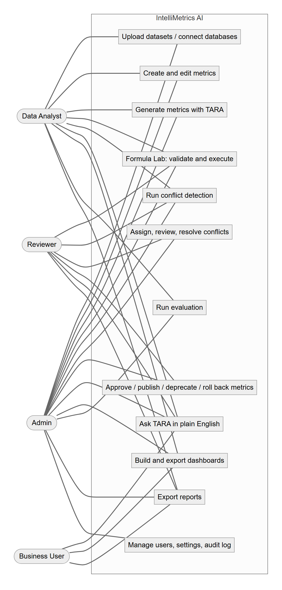{width=55%}

